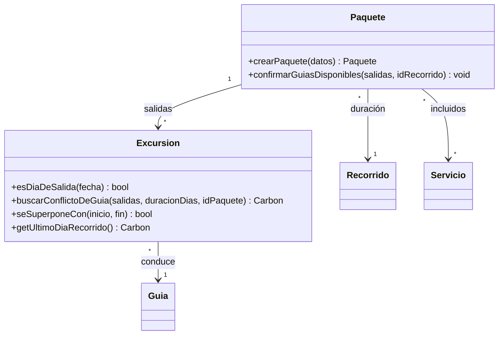

# Revisión de CU-01 Crear Paquete

Correcciones del PR #54 después de integrar CU-06 mediante el PR #53. Esta revisión complementa el Documento 3:
registra las reglas, las firmas y el diagrama de clases que deben usarse para CU-01. El caso de uso original está
descrito en forma breve; no se agrega un diagrama de secuencia que no formaba parte de su diseño.

## Reglas y alcance

- Sólo el administrador puede listar, consultar y crear paquetes en el panel. El guía recibe 403 también por URL
  directa y al intentar montar el componente de creación. El visitante debe iniciar sesión.
- Se exige nombre único, recorrido precargado, servicios y al menos una excursión. El paquete queda Activo y su
  fecha de creación es la fecha actual.
- Cada salida tiene una fecha futura que sea lunes, un cupo entero mayor que cero y un guía precargado.
  La fecha no puede repetirse dentro del paquete.
- Los precios y enteros respetan los máximos de NUMERIC(10,2) y SMALLINT del esquema. No cambia ninguna tabla ni columna.
- Un guía no puede conducir excursiones con períodos superpuestos, sean del mismo paquete o de otro.
  El último día del recorrido se incluye: salida más duración en días menos uno.
- R-01 permite crear una salida a menos de tres meses. El panel la muestra en la consulta administrativa de CU-06,
  pero el listado, la búsqueda y el detalle públicos la excluyen. CU-14 también la rechaza por URL directa.
  No se agrega al alta una restricción que R-01 no pide.

Modificar y dar de baja paquetes corresponden a CU-02 y CU-03.

## Orden del guardado y concurrencia

La página CreatePaquete habilita una transacción para el paquete, los servicios y las excursiones.

1. El formulario valida los datos y consulta los conflictos existentes para mostrar errores de campo.
2. Antes de crear el paquete, llama a Paquete::confirmarGuiasDisponibles(salidas, idRecorrido).
3. El modelo bloquea las filas de los guías con lockForUpdate(), ordenadas por id_usuario, y vuelve a comprobar
   todos los períodos. El recorrido determina la duración.
4. Si hay conflicto, se informa «No se creó el paquete» y se deshace la transacción. Todavía no existe un registro
   nuevo en el componente: el administrador puede corregir los datos y volver a enviarlos.
5. Si los guías siguen libres, se crea el paquete y Filament guarda sus servicios y excursiones. Se confirman
   juntos al terminar la transacción. Un error al guardar una relación deshace todas las escrituras.

El bloqueo ocurre **antes** de insertar las excursiones y sus claves foráneas. Dos altas con un guía común se turnan;
la segunda vuelve a consultar después de que termina la primera. Ordenar los guías evita que dos altas con varios
guías los bloqueen en órdenes opuestos. La comprobación posterior a las inserciones y el helper
buscarConflictoConGuiasBloqueados() de la versión anterior se retiran.

Este protocolo supone el aislamiento habitual READ COMMITTED de PostgreSQL y que las futuras altas o reasignaciones
de CU-02 usen el mismo orden: bloquear guías, comprobar períodos y recién después guardar.

## Firmas para el diagrama de clases

| Clase | Método | Retorno |
|---|---|---|
| Paquete | crearPaquete(array $datos), estático | Paquete |
| Paquete | confirmarGuiasDisponibles(array $salidas, int $idRecorrido), estático; dentro de la transacción | void |
| Excursion | esDiaDeSalida(Carbon $fecha), estático | bool |
| Excursion | buscarConflictoDeGuia(array $salidas, int $duracionDias, ?int $idPaquete = null), estático | ?Carbon |
| Excursion | seSuperponeCon(Carbon $inicio, Carbon $fin) | bool |
| Excursion | getUltimoDiaRecorrido() | Carbon |

Los métodos de consulta de CU-06 se conservan. El siguiente fragmento muestra las responsabilidades de CU-01 y sus
relaciones; complementa el diagrama general y no redefine el esquema de la base.

buscarConflictoDeGuia() devuelve null cuando no encuentra un conflicto. Los dos métodos de Paquete y los dos
primeros de Excursion son estáticos; los demás operan sobre una excursión.

## Integración con CU-06

El recurso conserva la vista ViewPaquete, PaqueteInfolist, la acción Ver, canView() y la ruta view.
La ruta literal /crear se declara antes de /{record}. El alta se habilita únicamente para Administrador.
Se conservan el filtro por estado y la consulta de paquetes activos e inactivos, incluidas todas sus excursiones.
Las pruebas de consulta administrativa y del portal deben seguir pasando junto a las del alta.

## Referencias

- [PR #54: CU-01](https://github.com/Tomacods/camino-del-inca/pull/54).
- [PR #53: CU-06 integrado](https://github.com/Tomacods/camino-del-inca/pull/53).
- [Documento 3](https://docs.google.com/document/d/17iZ6LTbCxcEfVidGTWvr20ESbPl0Ngq3/edit).
- [ERS, R-01 y R-14](https://docs.google.com/document/d/1JNYedQn15W8otheXpB3ZSXBlo-mCQAar/edit).
- [Diseño de CU-06](cambios-diseno-cu06.md).
- [Pruebas de CU-01](pruebas-crear-paquete.md).
