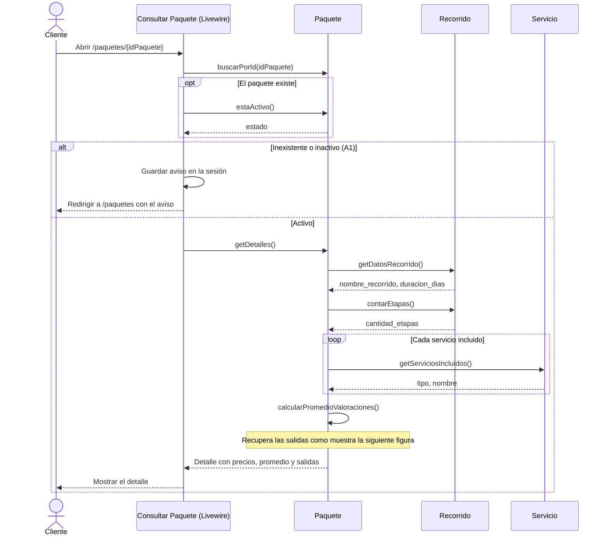
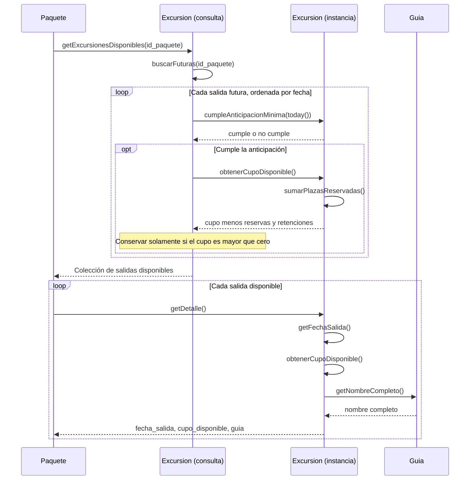
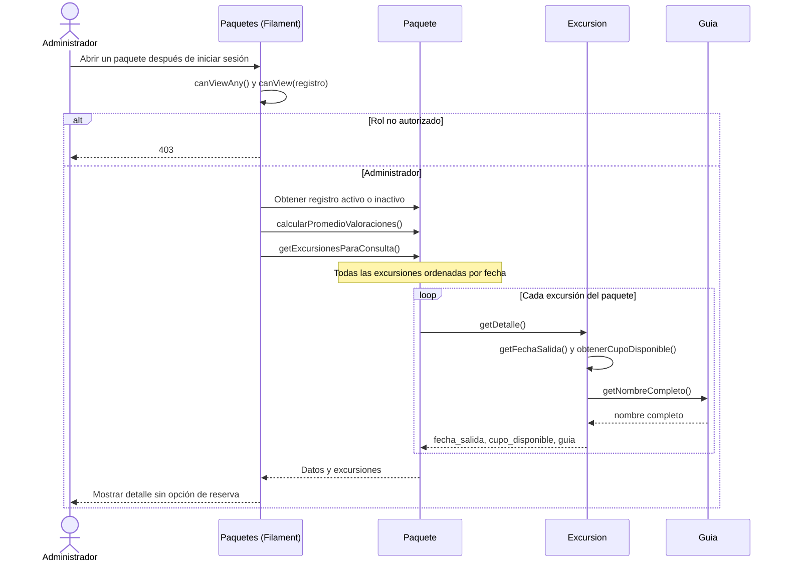

# Cambios de diseño por CU-06 Consultar Paquete

Ajustes de la revisión del PR #53 para que CU-06 y DS-06 coincidan con el portal y la consulta administrativa.
La [revisión editable del Drive](https://docs.google.com/document/d/1ZrazgNyMoCciwDL_V759mS9zRsrALbYws8G-mhT2APs/edit)
está en **Revisiones de código vs diseño** y complementa el Documento 3. Los archivos originales se conservan como
antecedentes; las reglas y secuencias corregidas de esta revisión son la referencia para CU-06.

## CU-05 y CU-06: salidas disponibles para el cliente

Reemplazar la regla que dice solamente «fecha futura y cupo mayor que cero» por:

> En el portal se consideran disponibles las excursiones cuya fecha de salida está a una anticipación mínima de
> tres meses calendario respecto de la fecha actual y cuyo cupo disponible es mayor que cero. La fecha exacta del
> límite se admite. El listado, el detalle y la búsqueda por fecha usan la misma regla que Realizar Reserva (CU-14).

El plazo se toma de `config('reserva.meses_anticipacion_minima')`, que vale 3. Se comparan días en la zona horaria de
la aplicación, `America/Argentina/Buenos_Aires`: reservar por la tarde no excluye la salida justo a los tres meses.
Al sumar meses se usa `addMonthsNoOverflow()`; si el mes de destino no tiene ese día, se toma su último día.

| Fecha actual | Límite | Ejemplo |
|---|---|---|
| 25/10/2026, incluso a las 23:59 | 25/01/2027 | La salida del lunes 25/01 se muestra y CU-14 la admite |
| 26/10/2026 | 26/01/2027 | La salida del 25/01 se excluye; la del lunes 01/02 sigue disponible |
| 30/11/2026 | 28/02/2027 | La salida del lunes 01/03 se admite; el límite no se desplaza al 02/03 |

El cupo sigue siendo derivado: cupo total menos integrantes de reservas «Pendiente», «Confirmada» o «Sin Permiso»,
menos plazas retenidas. Las reservas «Cancelada» y «Finalizada» no ocupan plazas. La anticipación se verifica antes de
calcular el cupo de cada salida. El filtro del portal no agrega una restricción al alta de excursiones de CU-01.

## CU-06: curso normal y alternativas

- **Curso normal:** el cliente consulta un paquete activo sin iniciar sesión. Ve el recorrido, las etapas, los
  servicios, los porteadores, los tres precios, la valoración promedio y las salidas disponibles con su cupo y guía.
  Si no hay salidas, se conserva el detalle y se informa «Por ahora no hay salidas disponibles».
- **A1:** si el paquete está inactivo, se guarda el aviso en la sesión y se redirige a `/paquetes`, donde se informa
  «Ese paquete no está disponible actualmente». Un identificador numérico inexistente recibe el mismo tratamiento.
- **A2:** cada botón «Reservar» abre `/reservar/{idPaquete}/{fechaSalida}`, con la fecha en formato `Y-m-d`.
  CU-14 vuelve a validar la anticipación, el estado del paquete y el cupo: la salida puede haber dejado de estar
  disponible entre la consulta y la reserva.
- Los precios se muestran en USD con dos decimales. Sin valoraciones se informa que todavía no las tiene; no se
  presenta cero como si fuera una valoración.

## DS-06: consulta y datos del paquete

`Recorrido::getDatosRecorrido()` devuelve el nombre y la duración. `Paquete::getDetalles()` llama por separado a
`Recorrido::contarEtapas()`. Así se conserva el contrato de `getDatosRecorrido()`, compartido con CU-13.

El componente Livewire consulta el estado al entrar y al obtener el detalle. En el diagrama se resume esa
coordinación; los datos y los cálculos siguen a cargo de los modelos.

### Salidas y cupo dentro de getDetalles()

El filtro de disponibilidad devuelve modelos `Excursion`. Luego `Paquete::getDetalles()` llama a `getDetalle()`
sobre cada salida aceptada. No se obtiene primero el detalle de todas las salidas futuras para filtrarlas después.

En DS-05 también debe aparecer `cumpleAnticipacionMinima(today())` antes del filtro de cupo. La búsqueda por fecha
llama a `tieneFechaSalida()`, que aplica la misma anticipación y comprueba el cupo de esa fecha.

### Promedio y diagrama de clases

Agregar al DS-06 la llamada `Paquete::calcularPromedioValoraciones()` dentro de `getDetalles()`. El método toma
el promedio de `puntaje_experiencia_general` de las valoraciones asociadas a las reservas de las excursiones del
paquete. La consulta filtra por `reserva.excursion.id_paquete`; las valoraciones de otro paquete no intervienen.
Devuelve `null` si no hay valoraciones y, si las hay, redondea a un decimal. Es derivado y no agrega una columna.

Verificar estos métodos en el diagrama de clases, con los nombres y las firmas del código:

| Clase | Método público | Retorno |
|---|---|---|
| Paquete | `buscarPorId(int $idPaquete)` (estático) | `?Paquete` |
| Paquete | `estaActivo()` | `bool` |
| Paquete | `getDetalles()` | `array` |
| Paquete | `getExcursionesParaConsulta()` | `array` |
| Paquete | `calcularPromedioValoraciones()` | `?float` |
| Recorrido | `getDatosRecorrido()` | `array` |
| Recorrido | `contarEtapas()` | `int` |
| Excursion | `getExcursionesDisponibles(int $idPaquete)` (estático) | `Collection` |
| Excursion | `tieneFechaSalida(int $idPaquete, Carbon $fecha)` (estático) | `bool` |
| Excursion | `cumpleAnticipacionMinima($fecha)` | `bool` |
| Excursion | `obtenerCupoDisponible()` | `int` |
| Excursion | `getDetalle()` | `array` |

## Consulta administrativa

Después de iniciar sesión, el administrador abre `/admin/paquetes`, puede filtrar por estado y consultar paquetes
activos e inactivos mediante la acción **Ver**. El detalle muestra recorrido, duración, etapas, servicios, porteadores,
precios, promedio y todas las excursiones ordenadas por fecha, con su cupo disponible y guía. Incluye las pasadas,
las completas y las que no cumplen la anticipación: el filtro comercial de tres meses se aplica al portal.
Sin excursiones o valoraciones se muestra el aviso correspondiente. El panel no ofrece reservar.

`Paquete::getExcursionesParaConsulta()` obtiene las excursiones sin el filtro del portal y reutiliza
`Excursion::getDetalle()`; el cupo se sigue calculando con `obtenerCupoDisponible()`.
`PaqueteResource::canViewAny()` y `canView()` exigen el rol Administrador. El guía recibe 403 tanto en el listado
como en el detalle por URL directa; el visitante debe iniciar sesión. La sesión administrativa no permite
consultar paquetes inactivos por la ruta pública.

### Integración con CU-01 (PR #54)

El recurso se comparte con CU-01, CU-02, CU-03 y CU-05, según el [reparto](reparto-casos-de-uso.md).
El PR #54 agrega listado y creación en las mismas clases. Al resolver ese solapamiento, conservar `ViewPaquete`,
`PaqueteInfolist`, `canView()`, la ruta `view` y la acción **Ver**; agregar el formulario, la ruta `create` y la
acción de alta de CU-01, y cambiar `canCreate() = false` por su autorización exclusiva para Administrador.
Después se ejecutan las pruebas de ambos casos. Esta revisión no modifica ni integra el PR #54.

Las comprobaciones del portal y del panel están en [pruebas de CU-06](pruebas-consultar-paquete.md).

## Fuentes revisadas

- [PR #53: CU-06 Consultar Paquete](https://github.com/Tomacods/camino-del-inca/pull/53).
- [Documento 3: modelo de dominio y casos de uso](https://docs.google.com/document/d/17iZ6LTbCxcEfVidGTWvr20ESbPl0Ngq3/edit).
- [DS-06 Consultar Paquete](https://drive.google.com/file/d/1QcJjXcooXmIl41BQ-u7LZs9l1KlO1NKm/view).
